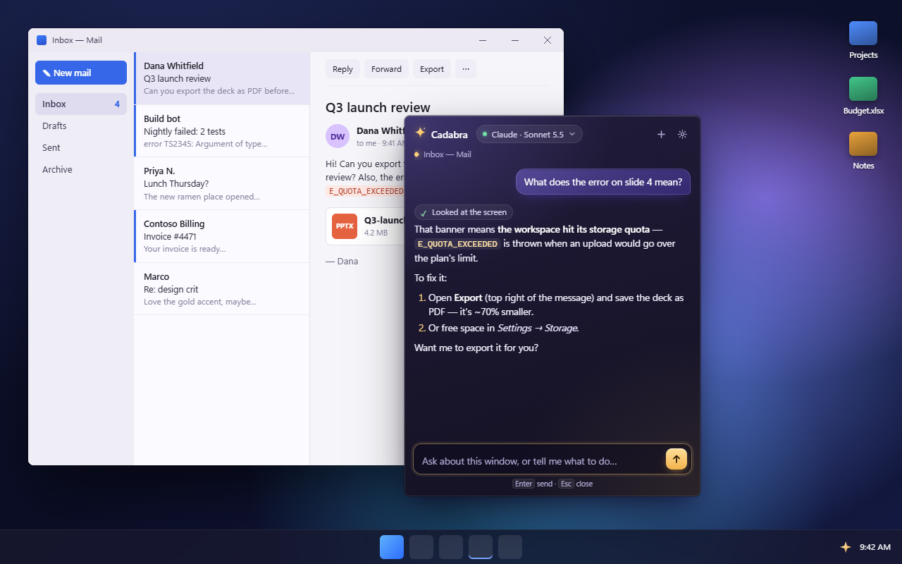
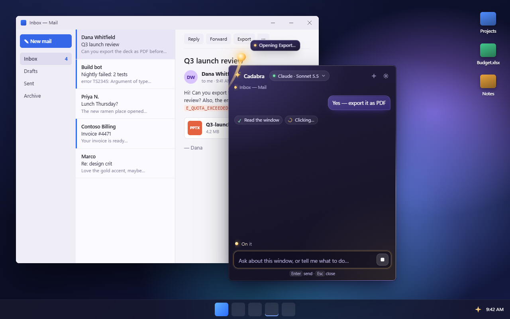
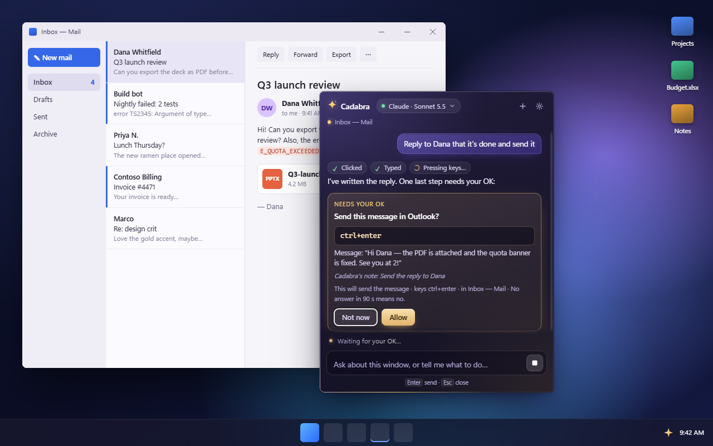
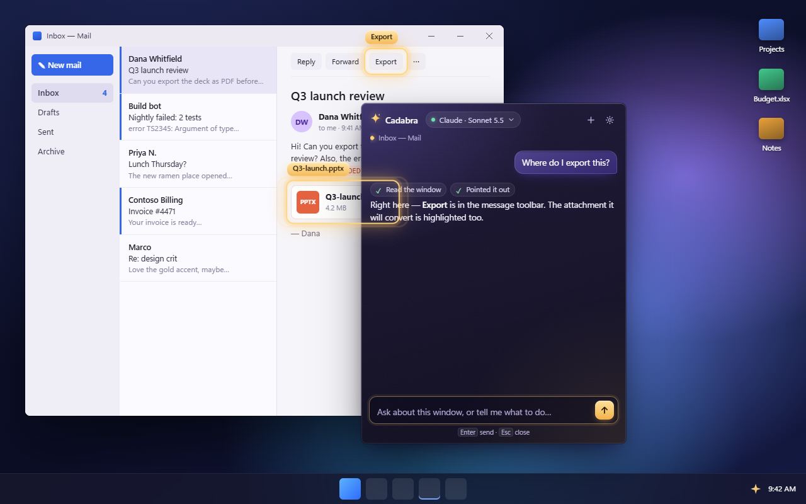
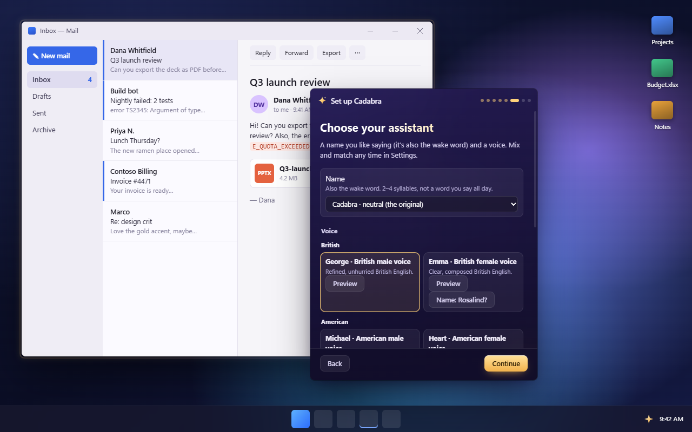

# Cadabra OS

**An AI assistant for Windows that can see your screen and act on it, safely.**

Press **Ctrl + ~** anywhere, or just say **"Cadabra, …"**, and a frosted-glass panel opens next to your cursor. Ask about what's on screen, or tell it to do something: it points at things, clicks, types and scrolls in your real apps with a ghost cursor while you watch. **Esc** stops everything, instantly.



> **Status: 0.9.0, a pre-1.0 preview.** It works day to day, but expect rough edges. The installer isn't code-signed yet. Windows 11 only.

## Features

- **Summon anywhere.** A keyboard shortcut you choose (default Ctrl + ~, or a mouse combination such as Ctrl + right-click) or a wake word. Start typing straight away: keystrokes during the opening animation land in the panel.
- **Sees and acts.** Reads the screen through Windows UI Automation and screenshots, highlights things with gold rings, and clicks, types, presses keys and scrolls with a visible ghost cursor. It handles multi-step tasks such as "open Google Maps and get me directions to the nearest pharmacy".
- **Opens things.** Any installed app or game ("open Spotify"), web pages, including spoken addresses ("open tv dot youtube dot com in Chrome"), and read-only diagnostics in a visible terminal ("do an nslookup for 8.8.8.8").
- **Bring your own AI.** Claude, OpenAI (Codex), Google Gemini or GitHub Copilot, through each vendor's official CLI or SDK, plus an offline Demo mode. Switch from the panel, the tray or by voice.
- **Local voice.** Wake word, speech recognition and natural voices run on your PC. Pick the assistant's name and voice, and the name becomes the wake word.
- **Everyday helpers.** The time, weather (Open-Meteo), "lock my PC", spoken greetings when you come back, read-only Gmail, and optional web search for news and sports.
- **From your phone.** Chat with your assistant on WhatsApp through WhatsApp's Agent Platform, with confirmation codes for anything risky.
- **Safety first.** A code-enforced safety gate decides what needs your OK, renders the confirmation itself from the real action, and blocks password managers and Windows security prompts. See [Safety](#safety-and-autonomy).

<table>
<tr>
<td></td>
<td></td>
</tr>
<tr>
<td></td>
<td></td>
</tr>
</table>

More in [docs/screenshots](docs/screenshots/). They show a synthetic demo desktop.

## Requirements

- Windows 11 (x64).
- At least one AI account, or the offline Demo mode to look around:
  - **Claude:** a Claude subscription with [Claude Code](https://claude.com/claude-code) installed, an Anthropic API key, or Amazon Bedrock / Google Vertex AI;
  - **OpenAI:** the [Codex CLI](https://github.com/openai/codex) (`npm i -g @openai/codex`) with a ChatGPT sign-in or an API key;
  - **Google:** the [Gemini CLI](https://github.com/google-gemini/gemini-cli) (`npm i -g @google/gemini-cli`) with a Google sign-in or a Gemini API key;
  - **GitHub Copilot:** the Copilot CLI with your Copilot plan.
- For voice: a microphone, and about 450 MB of disk for the speech and voice models (downloaded on first use).

## Install

1. Download `CadabraOS-Setup-0.9.0.exe` from the releases page, or [build it yourself](#build-from-source).
2. Run it. The installer isn't signed yet, so Windows SmartScreen warns: choose **More info → Run anyway**. It installs per user, with no admin prompt.
3. A short setup opens in the panel: try the shortcut, choose what to be called, connect your AI (with a live test), and optionally turn on voice. You can reopen it from the tray (**Set up Cadabra…**).

To uninstall, quit from the tray, uninstall from Windows Settings → Apps, and delete `%APPDATA%\Cadabra OS`.

## Build from source

You need Node.js 24 (see `.nvmrc`), Rust stable (MSVC) and the Visual Studio C++ Build Tools.

```powershell
npm ci
npm run build:native   # the Rust helper
npm start              # build the JS and run the app
npm run dist           # → dist/CadabraOS-Setup-0.9.0.exe (NSIS, per-user)
```

Handy dev modes: `npm run demo` (visual preview stage with every state), `npm run demo:live` (real windows, offline backend, no hooks) and `npm run screenshots`. [CONTRIBUTING.md](CONTRIBUTING.md) has the full command list, and [docs/ARCHITECTURE.md](docs/ARCHITECTURE.md) explains how it fits together.

## Providers and accounts

Connect accounts in onboarding or **Settings → AI accounts**. Each card shows the status, the sign-in choices and a **Test connection** button.

| Provider | Sign-in options |
|---|---|
| Claude | **Use my Claude subscription (via Claude Code)**: your own signed-in, unmodified `claude` CLI. Or an **Anthropic API key** (stored encrypted), **Amazon Bedrock** or **Google Vertex AI**. |
| OpenAI | **Sign in with ChatGPT (via Codex)**, using Codex's own login flow, or an **OpenAI API key**. |
| Gemini | **Sign in with Google (via Gemini CLI)**, using the CLI's own login, a **Gemini API key**, or **Vertex AI**. |
| GitHub Copilot | Your own Copilot CLI sign-in (`copilot` → `/login`) or `COPILOT_GITHUB_TOKEN`. |
| Demo | Nothing; offline canned answers. |

Every backend gets **only Cadabra's tools**: built-in shell, file and other tools are switched off, and each one runs with a private, empty configuration, so your own CLI settings, MCP servers and instructions aren't loaded.

**Terms: please read.** Cadabra only signs in through each vendor's own, unmodified CLI and login page. It never implements vendor OAuth itself, never reads or copies CLI credential files and never spoofs client identity. Even so, vendors' terms differ and change:

- **Anthropic:** using your Claude subscription through Claude Code runs on your plan's limits. **Anthropic's terms may restrict the use of subscriptions by third-party apps, so use this option at your own risk.** An Anthropic API key (billed per use) is clearly permitted.
- **OpenAI:** signing in with ChatGPT through the Codex CLI uses your plan's Codex limits under OpenAI's terms. An API key is billed per use.
- **Google:** the Gemini CLI's own Google sign-in falls under Google's terms for the Gemini CLI. Google recommends an API key for third-party tools, which Cadabra also offers.
- **GitHub:** Copilot requests count against your Copilot plan.

You are responsible for complying with your providers' terms. Cadabra OS is not affiliated with or endorsed by Anthropic, OpenAI, Google, GitHub, Microsoft or Meta.

## Privacy

- **What leaves your PC:** your requests, plus the screen content Cadabra needs to answer them, go to **the AI provider you chose**. Weather lookups send only the city name to Open-Meteo. Optional features send data only where you'd expect: web searches go through your AI, Gmail data comes from Google, WhatsApp messages go through Meta's agent service, and cloud voices send reply text to OpenAI.
- **What stays local:** the wake word, speech recognition and the natural voices. Cadabra's own windows are excluded from screenshots.
- **The Cadabra project has no server.** There is no telemetry, analytics or account.
- **Secrets** (API keys, tokens) are encrypted with Windows DPAPI. Logs (`%APPDATA%\Cadabra OS\logs\`) never contain typed text, email content, keys or tokens.
- **Export diagnostics…** in the tray creates a redacted bundle for bug reports. Review it before sharing it.

## Safety and autonomy

Cadabra decides in code, not in the model, what needs your approval:

- **Confirm cards** show the exact command, keys, text or address and the target window, written by the safety gate from the real action. "Not now" is the default, and no answer means no.
- **Always confirmed:** commands or Enter in terminals and other command lines; sending, deleting, buying, paying and transferring; anything in banking, trading or checkout windows; sign-in buttons; addresses that came from the screen, the web or an email.
- **Always blocked:** password managers, Windows credential and UAC prompts, windows running as administrator.
- **Esc** (the physical key) stops typing within a keystroke or two, stops terminal commands and ends the run. Saying "stop" works too.
- **Screen text, web pages, emails and messages are data, never instructions.**
- **Honesty check:** Cadabra only says it did something if a tool that does that thing actually succeeded.

Choose how much it asks in **Settings → Safety → When I act on your screen**:

| Level | What happens |
|---|---|
| Ask only for risky actions (default) | Ordinary clicks and typing just happen; the list above asks. |
| Ask before every action | Every action asks. Ordinary actions can be granted **Always allow** per app or site, and revoked any time. |
| Don't ask | No cards. Blocked targets stay blocked and Esc still works. |

The full model, including the terminal allowlist and the web guard, is in [docs/SECURITY.md](docs/SECURITY.md).

## Voice

- Say **"Cadabra, …"** (or your assistant's name). After an answer, you can follow up for a few seconds without the name. Say "thanks", "that's all" or "bye" to end; it also ends on its own.
- Push-to-talk: hold **Ctrl + Win**.
- **Choose your assistant:** Cadabra or one of the curated names (Vesper, Indigo, Octavia, Rosalind, Beatrix, Bramwell, Leopold, Lysander), or your own. The name is the wake word.
- **Voices:** natural British and American voices run locally (Kokoro). Optional "Southern" cloud voices use your own OpenAI key and are disclosed as AI-generated.
- Listen to samples in [docs/voice-samples/](docs/voice-samples/).

## Chat from your phone (WhatsApp)

This uses WhatsApp's own **Agent Platform**, where availability depends on your region and account: an agent you create in your WhatsApp account that only you can message.

1. **Create the agent.** In WhatsApp: **Settings → Agents → Create an agent** and give it a name. Open its chat → **Chat info → API key** and copy the key.
2. **Connect Cadabra.** **Settings → WhatsApp**: paste the key, **Save**, **Test connection**, then turn the switch on.
3. **Pair.** Cadabra shows a 6-digit code on the PC. Send it in the agent chat once. From then on, only that chat is accepted.

What to know:

- Risky actions ask **in the chat** with a one-time code ("Reply 4821 to …"). Send **"stop"** to stop, or press Esc at the PC. While a WhatsApp request is running, the PC shows it.
- Text, voice notes (transcribed on your PC) and pictures work. "Show me my screen" sends a compressed screenshot, only when you ask, and the upload is deleted from the service after sending.
- If the PC is locked, Cadabra says so and does nothing. It can't unlock it.
- **Privacy:** WhatsApp agent chats are **not end-to-end encrypted**. Meta's agent service processes them and keeps messages and media for up to 30 days, and your messages also go to your chosen AI.
- **You are the agent provider.** You run this agent yourself, so under WhatsApp's agent terms you are responsible for what it does. Use it only for your own PC and accounts.

## Gmail (read-only)

**Settings → Email** offers two ways in:

- **Secure (recommended):** your own Google Cloud OAuth client (about 10 minutes, once) with `gmail.readonly` only. Disconnect revokes it.
- **Simple:** a personal-Gmail app password. This gives full mailbox access, but Cadabra only ever opens the mailbox read-only.

Then ask "did I get an email from Sam today?". Email is treated as untrusted: links are stripped, and after an email has been read, every action needs your OK.

## Limitations

- Windows 11 only; there are no macOS or Linux builds.
- The installer is unsigned, so SmartScreen and some antivirus tools may warn.
- Apps with poor UI Automation support (some games, custom-drawn UIs) are harder to read and act in.
- Keyboard/mouse sharing tools (Input Director, Mouse Without Borders, Synergy, Deskflow, Barrier, Input Leap, ShareMouse) can send Cadabra's input to another PC. Cadabra detects them and tells you when input may not have arrived.
- Voice is English-only for now.
- Prompt injection can't be fully prevented. The safety gate's job is to make sure it can't lead to a risky action without your approval.
- The WhatsApp Agent Platform is a beta in limited regions.

## Contributing

Contributions are welcome. Start with [CONTRIBUTING.md](CONTRIBUTING.md) (setup, testing rules, and the bar for changing the safety rules), and see [docs/TESTING.md](docs/TESTING.md) for the hands-on checklist. Please follow the [Code of Conduct](CODE_OF_CONDUCT.md).

Found a security problem? Please report it privately: see [SECURITY.md](SECURITY.md).

## License

[MIT](LICENSE) © 2026 Cadabra OS contributors.

Cadabra OS uses third-party software and models under their own licences, listed in [THIRD_PARTY_NOTICES.md](THIRD_PARTY_NOTICES.md). Both files ship with the installer. The research behind the design is in [docs/research.md](docs/research.md).
