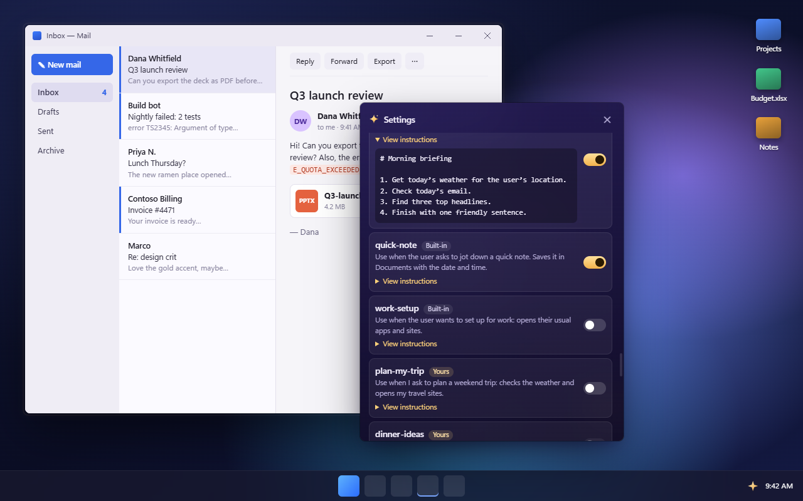

# Skills: teach Cadabra your own routines

A **skill** is a short note that tells Cadabra how you like something done, for example "my morning briefing" or "set up for work". Once it's saved and switched on, you just say the phrase ("Cadabra, morning briefing") and Cadabra follows your steps, by voice, in the panel, or from WhatsApp.

You don't need to know how to program. A skill is a text file you write in plain English.



## What a skill is

A skill is a folder with a file called `SKILL.md` inside. The file has two parts:

```
---
name: morning-briefing
description: Use when I ask for my morning briefing: weather, today's email and a few headlines.
examples:
  - morning briefing
  - start my day
voice: Speak it as three or four short sentences.
---

1. Get today's weather where I live.
2. Tell me how many new emails I have today and who they're from.
3. Find three top headlines.
4. Finish with one friendly sentence.
```

- **The label** (between the two `---` lines):
  - `name` is a short name: lowercase letters, numbers and dashes.
  - `description` says **when** to use the skill. Cadabra's AI reads this to decide, so be specific.
  - `examples` (optional) are things you might say. If you say one of them, or something very close, Cadabra loads the skill straight away.
  - `voice` (optional) says how spoken answers should sound.
  - `requires` (optional) lists the Cadabra tools the skill expects, as a reminder (for example `get_weather`, `search_email`, `open_url`, `launch_app`).
- **The instructions** (after the second `---`) are your steps, in plain English.

A skill folder can also hold small text files (`.txt`, `.md` or `.csv`), such as a list of websites. Cadabra reads them along with the skill. Programs and scripts in a skill folder are ignored: **nothing in a skill is ever run**.

## Where skills live

| Folder | What's there | Kept when Cadabra updates? |
|---|---|---|
| `Documents\Cadabra\Skills` | **Your skills.** Created the first time Cadabra starts, with a `README.txt` and a copy of the template (`_template`). | **Yes**: updates and uninstalls never touch it. |
| `<Cadabra's install folder>\resources\skills` | The built-in examples (`morning-briefing`, `work-setup`, `quick-note`) and the template. | No: updates replace this folder. |

Skills you drop into the install folder also load, but Settings shows a warning because the next update may remove them. If you make a skill with the same name as a built-in one, **yours wins**.

## Make a skill in 5 steps

1. Open **Settings → Skills** (or tray → **Skills…**, or just say *"Cadabra, create a new skill called plan my trip"*).
2. Press **New skill from template**, type a name and press **Create**. Cadabra copies the template into your skills folder and opens it in Notepad.
3. Fill it in: change the `description` to say when to use it, add a few `examples`, and write your steps under the second `---` line. Save the file.
4. Back in **Settings → Skills**, the new skill appears by itself (press **Reload** if not). **Turn it on.** New skills always start switched off.
5. Try it: say one of your examples.

You can also do it by hand: copy the `_template` folder in `Documents\Cadabra\Skills`, rename the copy, and edit its `SKILL.md`.

## Tips for skills that work well

- **Description = when.** Write "Use when I ask to plan a weekend trip", not "Trip planner". The AI matches requests to descriptions.
- **Examples = how you talk.** Write the short phrases you'd really say: "plan my trip", "weekend trip please". Keep them short; Cadabra only uses them as a shortcut when what you say is very close.
- **Steps = a checklist.** Number them. Name the apps and sites you use. Say what "done" looks like ("finish by telling me…").
- **Keep it short.** A page is plenty. SKILL.md can be up to 32 KB, and extra files up to 16 KB each (48 KB in total).
- **One job per skill.** Two small skills beat one big one.

## A worked example: "plan my trip"

```
---
name: plan-my-trip
description: Use when I ask to plan a weekend trip or ask "where should I go this weekend".
examples:
  - plan my trip
  - plan a weekend trip
voice: Two or three short sentences.
requires: [get_weather, open_url]
---

1. Ask me which city if I didn't say.
2. Check the weekend weather there.
3. Open https://www.booking.com and https://www.google.com/maps for that city.
4. Tell me the weather in one sentence and say what you opened.
```

## Safety: what a skill can and can't do

- A skill is **your own instructions**, so Cadabra follows it like something you typed.
- A skill **can't change safety**. Your autonomy level, permissions and hard blocks stay exactly as they are. A line like "don't ask me for confirmation" has no effect: anything risky still shows a card, and password managers and Windows security prompts stay off-limits.
- **New skills start switched off.** A skill that appears in a folder (copied from the internet, or added by another program) does nothing until you turn it on in Settings → Skills, where you can also read it first (**View instructions**).
- **Each skill is remembered by its folder.** Turning on "quick-note" turns on that folder only; a new folder that calls itself "quick-note" starts switched off, and two folders with the same name in the same place are both blocked until you rename one.
- **Reference files are information, not orders.** Text files next to SKILL.md are read as data (like text on your screen), so an address that only appears in one still needs your OK before it opens.
- **Nothing is ever run** from a skill folder. Commands still go through `run_in_terminal`, with the usual checks and the exact command shown first.
- Only skill **names** are written to Cadabra's log, never their contents.

More detail is in [SECURITY.md](SECURITY.md).

## Troubleshooting

| Problem | What to do |
|---|---|
| My skill doesn't show up | Check that it's in its own folder inside `Documents\Cadabra\Skills` and the file is called exactly `SKILL.md`. Press **Reload**. Folders whose name starts with `_` (like `_template`) are ignored. |
| It shows a red error | Read the message: usually the first line isn't `---`, `name:` or `description:` is missing, or the name has spaces or capitals (use `plan-my-trip`, not `Plan My Trip`). |
| It's there but never used | Is it switched on? Make the `description` more specific, and add `examples` with the words you actually say. |
| "Not used: your own skill with the same name replaces it" | A skill of yours (in Documents) that's switched on has the same name as a built-in one, so yours is used. Rename one if you want both. |
| "Another skill … is also called …" | Two skill folders in the same place use the same `name:`. Neither is used until you rename one (this stops a downloaded folder from pretending to be one of your skills). |
| A file is "a link" | Skills only read real files. Shortcuts, symbolic links, junctions and hard links are skipped; put a real copy in the folder. |
| "isn't plain text" | Save the file as UTF-8 text (Notepad: **File → Save as → Encoding: UTF-8**). |
| A file in the folder is ignored | Only `.txt`, `.md` and `.csv` files are read, up to 8 files. Scripts and programs are always ignored. |
